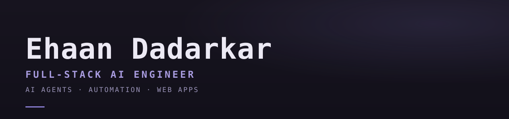
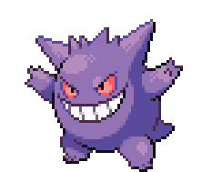
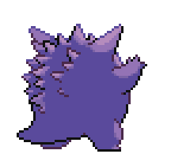

  

### hi, i'm ehaan

Full-stack AI engineer. I build **AI agents**, **automation**, and **web apps** — from idea to shipped product.

Navi Mumbai, India 
Building AI automations for real teams 
<a href="mailto:dadarkarehaan@gmail.com">dadarkarehaan@gmail.com</a>

gengar haunts this profile

 

  
  
  

  

## // stats

  
  

  

  

## // selected work

### MentorAI — AI learning platform

Active recall, adaptive learning, voice. PayPal AI Hackathon entry.
<a href="https://github.com/Ehaan-Dadarkar/MentorAI-Deployed">repo</a> · <a href="https://mentorai-prod.vercel.app/">live demo</a>

### VeriFace — facial attendance, local-first

Browser facial attendance. No backend, no cloud face API.
<a href="https://github.com/Ehaan-Dadarkar/Veriface">repo</a> · <a href="https://veriface-prod.vercel.app/">live demo</a>

### ArcDex — AI fitness OS, local-first

Nutrition, workouts, recovery, body progress. Zero backend, your data stays on device.
<a href="https://arc-dex-prod.vercel.app/">live demo</a>

### Oqera — meeting transcription, on-device

Speaker-aware meeting transcription, desktop app. Tauri + Rust, built for my father.

  

## // open source

**SurfSense** — 3 PRs merged. Open-source contribution, reviewed and shipped upstream. <a href="https://github.com/MODSetter/SurfSense">MODSetter/SurfSense</a>

## // stack

  
  
  
  
  
  
  
  
  

  

## // now

- Building **AI automations** — applicant screening, CRM pipelines, certificates, reporting.
- Levelling up **computer vision** and **real-time ML**.
- Open to remote internships and freelance AI work.

  
   built with intent — less, but intentional.

